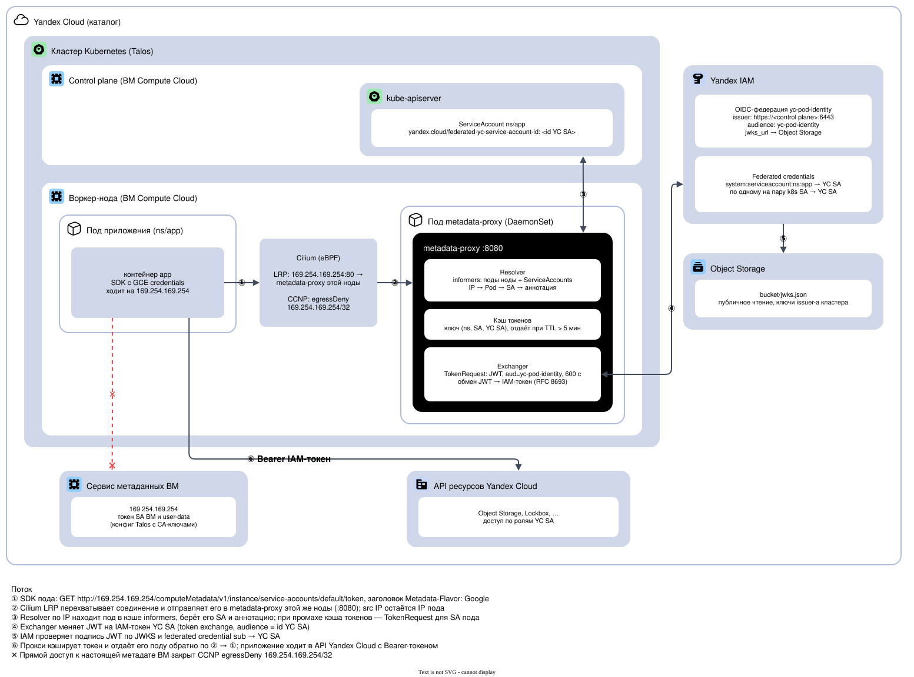

# yc-pod-identity

Metadata-прокси для self-hosted Kubernetes в Yandex Cloud (Talos + Cilium). Под получает IAM-токен своего
сервисного аккаунта YC через Workload Identity Federation по стандартному адресу метаданных `169.254.169.254` в
формате GCE: `yandex-cloud/go-sdk` работает без переменных окружения и сайдкаров. Тот же UX, что у
[WIF в Managed Service for Kubernetes](https://yandex.cloud/ru/docs/managed-kubernetes/tutorials/wlif-managed-k8s-integration),
включая аннотацию `yandex.cloud/federated-yc-service-account-id`.

Решения, фазы и что вне скоупа — [ROADMAP.md](ROADMAP.md).

## Как это работает

Под → `169.254.169.254:80` → CiliumLocalRedirectPolicy → прокси (DaemonSet) на той же ноде → по IP источника под
и его ServiceAccount → TokenRequest с audience федерации → обмен RFC 8693 на `auth.yandex.cloud/oauth/token` →
`{"access_token", "expires_in", "token_type": "Bearer"}`.



Прокси отвечает только на `/computeMetadata/v1/instance/service-accounts/default/token` и `/healthz`; остальные
пути — 404. Без заголовка `Metadata-Flavor: Google` или с `X-Forwarded-For` — 403 (как у GCE metadata, защита от
SSRF). Под, у SA которого нет аннотации, получает 404.
IAM-токен берётся из кэша, пока до его истечения больше 5 минут.

## Установка

### 1. Cilium

Нужны socket LB (`kubeProxyReplacement: true`) и Local Redirect Policy для адреса метаданных —
[spike/lrp/cilium-values.yaml](spike/lrp/cilium-values.yaml):

```yaml
localRedirectPolicies:
  enabled: true
  addressMatcherCIDRs:
    - 169.254.169.254/32
```

```bash
CILIUM_VERSION=$(helm -n kube-system get metadata cilium -o json | jq -r .version)  # не обновить CNI заодно
helm upgrade cilium cilium/cilium -n kube-system --version "$CILIUM_VERSION" --reuse-values -f spike/lrp/cilium-values.yaml
# При rollOutCiliumPods: false новый конфиг подхватывается только после рестарта.
kubectl -n kube-system rollout restart ds/cilium deploy/cilium-operator
kubectl get crd ciliumlocalredirectpolicies.cilium.io
```

### 2. Федерация

[terraform/](terraform/) создаёт OIDC-федерацию (JWKS кластера лежит в публичном бакете Object Storage, issuer
публиковать не нужно), YC SA и привязки `ns/sa` → YC SA. Переменные — [terraform/variables.tf](terraform/variables.tf).

```bash
terraform -chdir=terraform apply
terraform -chdir=terraform output -raw audience
terraform -chdir=terraform output service_account_ids   # "ns/sa" -> id YC SA
```

### 3. Чарт

```bash
helm install metadata-proxy ./charts/metadata-proxy -n yc-pod-identity --create-namespace \
  --set audience=$(terraform -chdir=terraform output -raw audience)
kubectl -n yc-pod-identity rollout status ds/metadata-proxy
```

Образ — `ghcr.io/nikolaymatrosov/yc-pod-identity`, тег по умолчанию — `appVersion` чарта. Пока не запушен git-тег `v0.1.0`, существуют только `:main` и
`:sha-<short>` — ставьте с `--set image.tag=main`. Для приватного пакета
нужен pull secret:

```bash
kubectl -n yc-pod-identity create secret docker-registry ghcr --docker-server=ghcr.io \
  --docker-username=<github-логин> --docker-password=<PAT с read:packages>
helm upgrade metadata-proxy ./charts/metadata-proxy -n yc-pod-identity --reuse-values \
  --set 'imagePullSecrets[0].name=ghcr'
```

Остальные параметры — [charts/metadata-proxy/values.yaml](charts/metadata-proxy/values.yaml).

### 4. Привязка k8s SA к YC SA

```yaml
apiVersion: v1
kind: ServiceAccount
metadata:
  name: demo
  namespace: wif-test
  annotations:
    yandex.cloud/federated-yc-service-account-id: <service_account_ids["wif-test/demo"]>
```

### 5. Проверка

```bash
kubectl -n wif-test run curl --rm -it --restart=Never --image=curlimages/curl \
  --overrides='{"spec":{"serviceAccountName":"demo"}}' -- \
  curl -s -H 'Metadata-Flavor: Google' \
  http://169.254.169.254/computeMetadata/v1/instance/service-accounts/default/token
```

Ожидается `{"access_token":"…","expires_in":…,"token_type":"Bearer"}`. Ошибка обмена в IAM — 502 с текстом ошибки
в теле (`invalid_client` — нет federated credential на пару SA + subject, `invalid_target` — не та audience).

## Deny-политика

LRP fail-open: пока на ноде нет готового пода прокси (раскатка, OOM, нода только поднялась), запросы к
`169.254.169.254` уходят в настоящие метаданные ВМ — к токену SA ВМ и user-data (у Talos там конфиг с CA-ключами).
Поэтому чарт по умолчанию ставит `CiliumClusterwideNetworkPolicy` с `egressDeny` на `169.254.169.254/32` для всех
подов. Перенаправленный трафик она не блокирует: socket LB подменяет адрес назначения ещё в `connect()`.

DaemonSet раскатывается без surge (`maxUnavailable: 1`): при `helm upgrade` на каждой ноде ~10 с нет прокси, и
запросы подов упираются в deny (таймаут). `yandex-cloud/go-sdk` это переживает на закэшированном токене. Surge
(`maxSurge: 1`) убрал бы окно, но при выключении ноды контроллер DaemonSet пересоздаёт отклонённые kubelet поды без
backoff — в e2e 110 подов за 5 с.

`denyPolicy.enabled=false` — только если такая политика в кластере уже есть. `helm uninstall` удаляет и LRP, и
deny-политику: кластер возвращается в состояние до установки.

Socket LB подменяет адрес назначения в `connect()`, поэтому NetworkPolicy видит `<IP пода прокси>:8080`, а не
`169.254.169.254:80`. В namespace с default-deny egress клиентским подам нужен egress-allow к подам
`app.kubernetes.io/name: metadata-proxy` в namespace релиза на TCP 8080; если в namespace релиза default-deny ingress,
прокси нужен ingress-allow от клиентских подов на TCP 8080. Иначе — таймаут.

## hostNetwork

При socket LB (`kubeProxyReplacement: true`) LRP перехватывает `connect()` и в host namespace. Пока прокси на ноде
готов, hostNetwork-поды и процессы ноды попадают в него и получают 404 — ни токена, ни метаданных ВМ. Без готового
прокси (раскатка, OOM, старт ноды) LRP fail-open, а deny-политика host namespace не выбирает: они снова видят настоящие
метаданные. Штатного способа исключить host namespace из LRP в Cilium 1.20 нет. Всё, что на hostNetwork читает
метаданные, с прокси работает с перебоями: например, CSI-драйвер Yandex Cloud (ID ВМ и зона), пока прокси готов,
получает 404. Passthrough для host namespace —
[#14](https://github.com/nikolaymatrosov/yc-pod-identity/issues/14).

## Безопасность

RBAC не ограничивает audience для `create serviceaccounts/token`, поэтому чарт ставит ValidatingAdmissionPolicy: SA
прокси может создавать только TokenRequest с `audiences == [audience]` (нужен Kubernetes ≥ 1.30, VAP v1). Остаточный
радиус поражения при взломе прокси: токены любой SA с audience федерации (то есть любой федеративной SA в YC) и чтение
всех спеков подов (list/watch pods). Прокси стоит и на пути метаданных host namespace (см. «hostNetwork»): взломанный
прокси может отдавать процессам ноды и hostNetwork-подам произвольные ответы.
